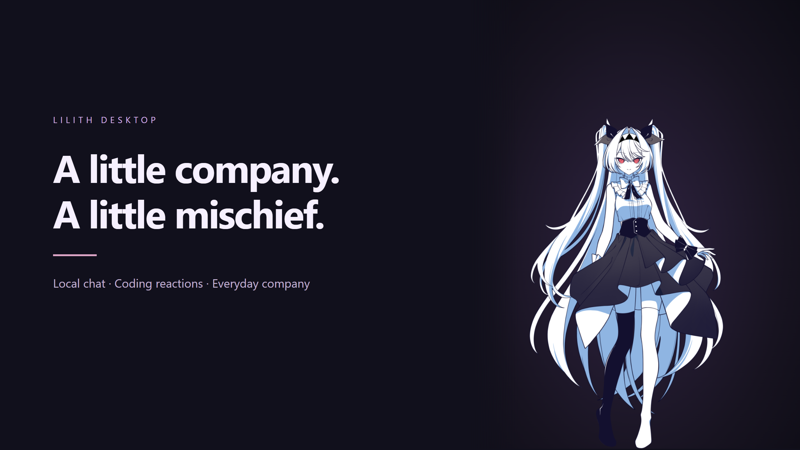
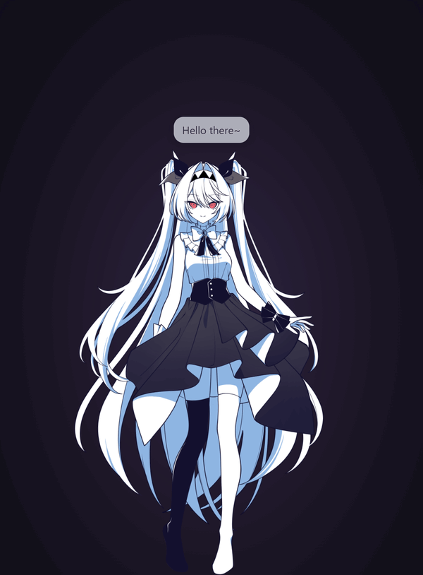
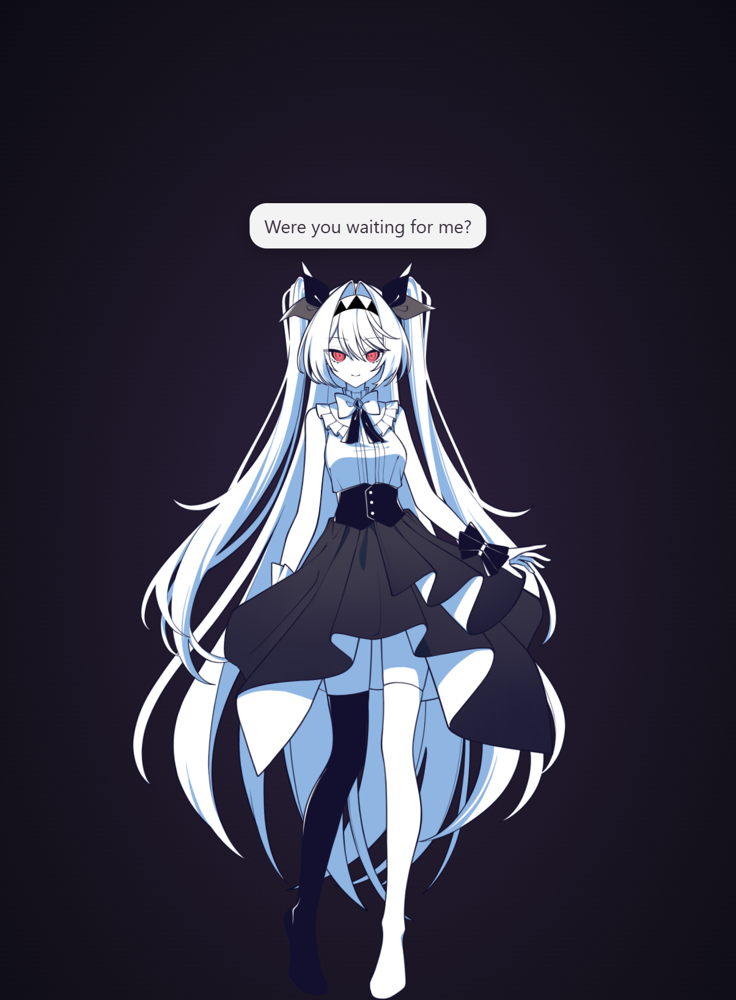
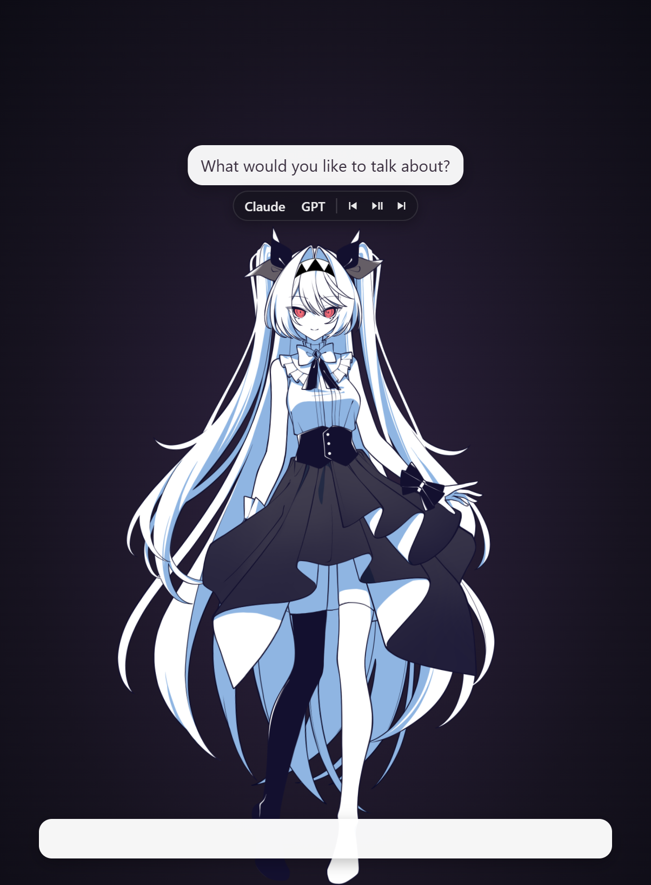

<p align="center">
  
</p>

<h1 align="center">✦ Lilith Desktop ✦</h1>

<p align="center">
  <strong>Your desktop, with a little more personality.</strong><br>
  An unofficial fan-made companion with local chat, coding reactions, and everyday company.
</p>

<p align="center">
  
  
  
</p>

<p align="center">
  <a href="https://github.com/nuttyuwu/lilith-desktop/releases/tag/v1.0.1-rc.6"><strong>Download Lilith</strong></a> ·
  <a href="#see-her-on-your-desktop">Demo gallery</a> ·
  <a href="#give-lilith-a-chat-model">Set up her chat model</a> ·
  <a href="#controls">Controls</a>
</p>

---

## Why I made this

I'll be honest: I'm not happy with where the second game is going. To me, it stripped away much of the original game's theme and aesthetic, and I don't really care for that direction. Those were a big part of why the original stayed with me.

Even though I don't like where the second game is going, I still like its desktop pet, and I want people to support the creators by getting the game themselves. This app starts with your own installed copy of the game and prepares the assets from it once.

What I do like is Lilith's existing desktop pet. The game's creators had already done the character work: the model, animations, expressions, voices, and all those little reactions. That was the part I wanted to spend more time with.

The desktop pet was already there. I wanted to build on that idea with something more interactive: a companion that reacts to what I'm doing, notices the hour, and becomes part of my workflow. This project builds a Windows desktop app around the character rig and assets read from your own installed copy of the game.

So I added Claude Code reactions, time and day awareness, Spotify controls, and local chat through Ollama. She can still walk around, rest, change clothes, and react when you click her. Now she also has more to respond to while you're actually using your computer.

## See her on your desktop

<p align="center">
  <br>
  <strong>A little hello. A little magic. A lot of personality.</strong>
</p>

*Silent animation showcase captured frame by frame from the app's renderer, with a staged backdrop and captions. These are Lilith's actual character animations; the captions are demo text, not generated chat replies.*

<table>
  <tr>
    <td align="center" width="50%"><br><strong>A familiar face</strong><br>Animated expressions, little greetings, and the original character's charm.</td>
    <td align="center" width="50%"><br><strong>More ways to interact</strong><br>Open chat, reach your coding tools, and control music from her compact interface.</td>
  </tr>
</table>

*Cursor-free, lossless PNG captures from the app's renderer, with a staged backdrop and demo dialogue. Click an image to view it at full resolution. Character artwork and animations belong to the original game's creators.*

## Make yourself at home

| 💬 Talk | ✦ Work together | ☾ Keep company |
|---|---|---|
| Local conversation through Ollama and Llama 3.2. | Reactions to Claude Code activity and access to coding tools. | Time-aware reactions, outfits, and little moments throughout the day. |
| [Set up the model](#give-lilith-a-chat-model) | [Integration details](#optional-integrations-and-local-data) | [Learn the controls](#controls) |

> **Getting started:** install the original game → [download Lilith](https://github.com/nuttyuwu/lilith-desktop/releases/tag/v1.0.1-rc.6) → click **Start** to prepare her assets. For generated chat, [install Ollama and the model](#give-lilith-a-chat-model).

## What I added

- **Claude Code reactions:** Lilith responds to coding activity through local hooks.
- **Time and day awareness:** reactions and outfit changes tied to your computer's clock.
- **Local conversation:** chat through Ollama with a model running on your computer.
- **Spotify controls:** playback controls and music-related reactions.
- **App awareness:** reactions to what you're doing, with a switch to turn this off.
- **Desktop controls:** draggable placement, four sizes, outfit choices, and a tuck-away shortcut.

The character, artwork, animations, and voices belong to the original game's creators. My contribution is the desktop app and its added interactions.

## Current status

**Version `1.0.1-rc.6` — private prerelease.** The Windows builds include bundled asset preparation, chat-model guidance, smoother tuck/return movement, scaled-display movement corrections, game-style controls, and a voice playback check. The earlier `rc.1` received focused manual checks for installation, launch, screen-edge placement, size changes, hook preference persistence, and quitting; those observations are not a clean-machine validation of this new setup flow.

This is still a work in progress. Clean-machine setup, audio, sleep/wake, multiple monitors, and a continuously observed long run need more testing. See the [release notes](CHANGELOG.md) and [validation record](docs/RELEASE.md) for the exact coverage.

Source and downloads are available in the private `nuttyuwu/lilith-desktop` repository. A public release has not been published; distribution of the game-derived face icon and the Spine runtime still needs to be cleared.

## Requirements

- Windows x64. Windows 11 is the platform used for the recorded manual session; other Windows versions have not been verified for this candidate.
- Your own installed copy of *The NOexistenceN of Lilith* for first-time asset preparation. Install the game before setting up this companion. After preparation, Lilith reuses the extracted assets in `%USERPROFILE%\LilithRip`; normal use does not require another extraction or the original game files.
- No separate Python installation is needed for the Windows executables: the extraction tool and its dependencies are included. Python 3.12 is a build-from-source prerequisite only.
- About 1–2 GB for extracted game data, in addition to the app and any optional Ollama models. Size and duration vary with the game version.
- Optional: Spotify desktop for music controls; Ollama with a downloaded chat model for generated replies; Claude Code and Node.js on PATH for coding activity reactions.

The animated model, textures, voices, and dialogue are extracted from the player's installed game once, then loaded from the extracted asset folder. These assets are not bundled in the current executables or downloaded from this project. The current local build also contains a face icon copied from the game; permission to redistribute that artwork has not been established. Do not treat the local build as cleared for public redistribution.

## Install or run

Download the current [private prerelease](https://github.com/nuttyuwu/lilith-desktop/releases/tag/v1.0.1-rc.6). You must have access to this repository to view its files. The Windows binaries are unsigned.

| File | Use |
|---|---|
| `Lilith.Setup.<version>.exe` | Install Lilith with Desktop and Start Menu shortcuts. Current-user installation is the manually checked option. |
| `Lilith.exe` | Run without installing the app. The runtime extracts temporarily and is removed on exit; settings and extracted game data remain in your user folders. |

The locally built executables are unsigned. Publisher signing has not been configured.

For a fresh setup, install *The NOexistenceN of Lilith* through Steam, then launch this companion to prepare the assets from your copy. If the game cannot be found, setup offers to find it on Steam or lets you choose its installed folder. Preparation cannot continue without the game files.

Lilith checks for the required extracted assets at startup. If they are already present, she can run without the original game files or another extraction. Keep the extracted asset folder: the app uses it on every launch.

If required extracted files are missing, Lilith asks to prepare them from your installed game. It looks in Steam libraries; if it cannot find the game, choose the folder containing `Lilith_Data`. Preparation runs the included extraction tool without installing Python or downloading dependencies. Click Start once to begin; Lilith opens when preparation finishes. If you open Steam from setup, click Check again after the game finishes installing; there is no need to restart Lilith. Extracted files go into `%USERPROFILE%\LilithRip` by default.

If an instance is already running, launching again brings that instance back into view. Use the tray menu to quit before testing a different build.

## Controls

| Action | Control |
|---|---|
| Open the app menu | Right-click Lilith's system-tray icon; it may be in the hidden-icons area. |
| Tuck or bring her back | `Ctrl+Alt+C` |
| Open chat and conversation topics | `Ctrl+Alt+L`, or right-click → Talk to Lilith… |
| Move her | Drag the character, then release. |
| Change outfit, size, screen, voice, or language | Tray → Settings, or the outfit items in the tray menu |
| Recenter her | Tray → Settings → Reset position |
| Play a demonstration | Tray → Demo |
| Exit | Tray → Quit |

The tray also controls app awareness, fullscreen hiding, day/night behavior, chatter frequency, and whether she stays on top. Audio, the full animation reel, and other unobserved behavior remain NOT TESTED; see the release notes for the exact coverage.

## Give Lilith a chat model

The model used with this project is **Llama 3.2 (`llama3.2:latest`) through Ollama**. The game provides Lilith's existing voice clips and reactions; the local language model lets her generate new chat replies.

1. [Download Ollama for Windows](https://ollama.com/download/windows), install it, and open it.
2. Open PowerShell and download the model:

   ```powershell
   ollama pull llama3.2:latest
   ```

3. Wait for the download to finish, then talk to Lilith with **Ctrl+Alt+L**. If she is already running, try chatting again; reinstalling Lilith is unnecessary.

[Model download page and details](https://ollama.com/library/llama3.2). The default model currently has 3 billion parameters and a download of about 2 GB. The model download needs internet access; once installed, chat uses the local Ollama service by default.

At launch, Lilith checks whether her chat backend and a model are available. If Ollama is unavailable, her speech bubble offers this setup guide. If Ollama is running without a chat model, she says, “In order for me to chat with you, please install the Llama 3.2 model,” and clicking the bubble copies the download command. This is an on-screen setup message, not newly synthesized voice audio.

If Ollama is already installed but stopped, open it or try chatting so Lilith can attempt to start it. For a custom `LILITH_OLLAMA` endpoint, make sure that server is reachable and has the model installed. `LILITH_MODEL` can select another installed model; otherwise Lilith prefers an installed model named Lilith, then `llama3.2:latest`, then another non-embedding model. Basic pet animations and recorded reactions still work without a language model.

## Optional integrations and local data

| Location or service | What it is used for |
|---|---|
| `%APPDATA%\lilith-pet\` | Settings and profile answers, day/activity records, Electron local storage, and the stable Claude hook scripts. |
| `%USERPROFILE%\LilithRip\` | Extracted model, images, dialogue, voices, sound effects, and the rotating `lilith-pet.log`. |
| `%USERPROFILE%\.claude\settings.json` | Claude Code hook registration. An existing file is backed up as `settings.json.lilith-bak` before the first write. |
| `127.0.0.1:47824` | Default local Claude event receiver. |
| `http://127.0.0.1:11434` | Default Ollama endpoint. |

**Ollama:** chat sends the conversation and persona context to the configured endpoint. Claude completion summaries can also be sent there. A stopped local Ollama service may be started when you use chat. Changing `LILITH_OLLAMA` to another host sends that content to that host; the default loopback address is not a guarantee for a customized configuration.

**Claude Code:** the tray's Claude hook preference persists across launches. Hook events can include prompts, paths, command descriptions, and Claude's last reply. The Node hook trims events before sending them to the local receiver; Node.js on PATH is required, and a missing Node executable is reported instead of falling back to an untrimmed request. Hook scripts are stored under the app's user-data directory so the portable runtime's temporary cleanup does not remove them. Registration replaces legacy Lilith hook entries and passes the configured `LILITH_PORT` to the hook command. `LILITH_NO_HOOK=1` prevents automatic registration on that launch. Candidate runtime verification is recorded separately in [Release preparation](docs/RELEASE.md).

**App awareness:** the Windows watcher reads foreground application information and window titles locally to classify activity and recognize private contexts. Day records use app names and times. The app-awareness switch disables those comments and recording of the current app name. Do not publish raw settings, copied logs, screenshots, extracted data, or hook backups: they may contain personal information.

The installer retains app data on uninstall. Quit Lilith and make your own backup before changing or removing saved data. The portable build also uses these user-data locations.

## Build from source

Use Windows with Node.js, npm, and Python 3.12 (including the Windows `py` launcher). Release builds create an isolated build environment and bundle Python, UnityPy, and their runtime dependencies; end users do not install them. The pinned dependency list is in `scripts/extractor-requirements.txt`. Electron `45.2.1` and electron-builder `26.18.0` are pinned in `lilith-pet/package-lock.json`. The manual GitHub build workflow uses Node.js 24.

```bash
cd lilith-pet
npm ci
npm start
```

Prepare a local release candidate:

```bash
cd lilith-pet
npm run release:prepare
```

This command rebuilds both x64 executables with publishing disabled, checks the packaged runtime and source against the pinned inputs, and assembles an allowlisted source archive, manifests, release notes, and SHA-256 checksums under `release/v1.0.1-rc.3/`. The build outputs also remain in `lilith-pet/dist/`. Building downloads Electron and packaging tools if they are not cached. The command does not upload anything; a successful build does not replace the manual checks in [Release preparation](docs/RELEASE.md).

Use the candidate's `SHA256SUMS.txt` and `BUILD_INFO.json` for exact artifact hashes and build information. The GitHub Actions workflow runs only when manually dispatched. It saves a candidate artifact for review and does not publish a GitHub release or run the automated test suite.

For DevTools, launch from Git Bash with:

```bash
LILITH_DEBUG=1 npm start
```

| Environment variable | Purpose |
|---|---|
| `LILITH_GAME` | Installed game folder containing `Lilith_Data`. |
| `LILITH_RIP` | Extracted-data and log directory. |
| `LILITH_PYTHON` | Python executable for source development; packaged builds use the bundled extractor. |
| `LILITH_OLLAMA` | Ollama base URL; default is loopback. |
| `LILITH_MODEL` | Ollama model name. |
| `LILITH_PORT` | Local Claude hook port; registration passes this value to its hook command. |
| `LILITH_NO_HOOK` | Any nonempty value prevents automatic Claude hook registration on launch. |

## Troubleshooting and reports

- **No character:** confirm the game is installed, then inspect the preparation message or log. The Windows build includes its own extraction runtime. Existing cached data can make a launch succeed without exercising first-time extraction.
- **Chat has no response:** check Ollama is installed, a chat model is downloaded, and the configured endpoint is reachable. Include whether the tray shows Ollama running.
- **Character is off-screen:** use Reset position and report the display scale, selected size, monitor arrangement, outfit, and preceding steps.
- **Need diagnostics:** Tray → Copy log includes versions and recent log output. Review it for private information before sharing.

For a useful issue, include the app version, installer or portable build, Windows version, display scale, reproduction steps, expected behavior, actual behavior, and a cropped screenshot when appropriate. See [CONTRIBUTING.md](CONTRIBUTING.md).

## Attribution and distribution status

This is an unofficial fan project, not affiliated with the game's developers or publisher. Buying or installing the game is not documented here as permission to redistribute its artwork or assets.

The project depends on Esoteric Software's Spine runtime under its [Spine Runtimes License](https://esotericsoftware.com/spine-runtimes-license), with conditions referring to the [Spine Editor License Agreement](https://esotericsoftware.com/spine-editor-license). It is not an MIT-licensed dependency. See [THIRD_PARTY_NOTICES.md](THIRD_PARTY_NOTICES.md) for the included notices and outstanding distribution questions. The project's own package metadata remains `UNLICENSED` unless the rights holder chooses a source-code license. No new license grant is implied by this README.

### If Lilith is silent

Use **Voice** on her toolbar, or **Settings → Voice → Test voice** in the tray menu. Select Japanese or Chinese if her voice is off. If there is no playback error but you hear nothing, check Windows mute, Volume mixer, and the selected output device. The game’s recorded lines have voices; generated Ollama chat and setup notices are text-only, with no text-to-speech engine.

Right-click Lilith for the original desktop pet’s white-button controls. Dress up changes her outfit; More controls contains voice testing, Claude/Codex, music, tuck away, and the full tray settings. Escape or clicking another app closes the menu. Button artwork is loaded from your own extracted game assets.
